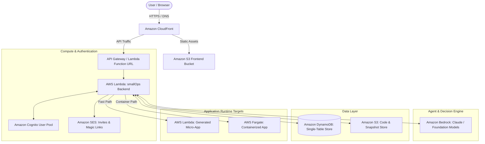

# PROJECT REPORT

---

# **smallOps: Autonomous Prompt-to-Cloud Serverless Application Engine**

**Academic & Technical Assessment Submission Report**  
**Domain:** Cloud Computing, Generative AI & Serverless Systems  
**Primary Cloud Provider:** Amazon Web Services (AWS)  

---

## 1. Project Title & Objectives

### 1.1 Project Title
**smallOps: Autonomous Prompt-to-Cloud Serverless Application Engine**

### 1.2 Project Objectives
1. **Democratize Cloud Deployment:** Enable non-technical users and developers to translate natural language descriptions into live, secure, production-grade cloud applications within 15–30 seconds.
2. **Serverless-First AWS Infrastructure:** Leverage AWS serverless paradigms (AWS Lambda, Amazon DynamoDB, Amazon S3, Amazon CloudFront) to achieve zero idle cost, high availability, and auto-scaling.
3. **Out-of-the-Box Security & Identity:** Implement zero-configuration enterprise authentication and role-based access control (RBAC) using Amazon Cognito and AWS IAM.
4. **Immutable Decision Traceability:** Maintain an immutable audit graph of all agent decisions, code diffs, and deployment snapshots using DynamoDB Single-Table Design, enabling deterministic one-click rollbacks.
5. **Autonomous Self-Healing:** Implement autonomous maintenance routines using Amazon Bedrock to monitor application health, analyze runtime errors, and deploy verified fixes without human intervention.

---

## 2. Introduction & Problem Statement

### 2.1 Problem Statement
Modern generative AI models can generate functional application code in seconds. However, transitioning raw generated code into a production-ready application requires extensive DevOps expertise:
* Provisioning virtual machines, containers, or serverless runtimes.
* Configuring VPCs, subnets, routing tables, and security groups.
* Implementing authentication, session handling, and access control.
* Setting up CI/CD pipelines, storage buckets, and domain routing.
* Managing breakages, dependency mismatches, and maintenance loops.

For small, single-purpose software (internal tools, prototypes, micro-dashboards), this infrastructure overhead introduces friction and delays delivery.

### 2.2 Proposed Solution: smallOps
**smallOps** bridges the gap between natural language prompting and live cloud deployment. Powered by AWS foundation services and Amazon Bedrock, smallOps receives user intent, clarifies ambiguities upfront, generates tested code, provisions serverless AWS resources on demand, secures the deployment with Amazon Cognito, and provides continuous health monitoring with automated rollback capabilities.

---

## 3. AWS Services Used and Their Purpose

| AWS Service | Category | Specific Role in smallOps |
| :--- | :--- | :--- |
| **Amazon Bedrock** | Generative AI | Powers requirement disambiguation, multi-step planning, code synthesis, and automated root-cause bug repair. |
| **AWS Lambda** | Serverless Compute | Executes the backend FastAPI orchestration engine and serves as the lightweight fast-path runtime for deployed applications. |
| **AWS Fargate (Amazon ECS)** | Container Compute | Provides sandboxed Docker container environments for complex, multi-tier, or stateful generated applications. |
| **Amazon DynamoDB** | NoSQL Database | Single-table database storing application state, decision timeline nodes, code snapshots, and audit trails. |
| **Amazon S3** | Object Storage | Hosts static frontend assets (HTML/React), build artifacts, and deployed web application bundles. |
| **Amazon CloudFront** | CDN & Edge Routing | Global Content Delivery Network providing low-latency, edge-cached HTTPS access to applications. |
| **Amazon Cognito** | Identity & Access | Manages user pools, OTP/magic-link authentication, JWT issuance, and Viewer/Editor roles. |
| **Amazon SES** | Communication | Dispatches automated workspace invitations and secure login tokens to team members. |
| **AWS IAM** | Security & Governance | Enforces granular least-privilege execution roles for Lambda, ECS, Bedrock, and DynamoDB. |
| **AWS VPC & Security Groups** | Networking | Isolates compute workloads, controls inbound/outbound traffic, and prevents unauthorized network exposure. |
| **AWS CDK (TypeScript)** | Infrastructure as Code | Programmatically defines and provisions all AWS resources in a repeatable, version-controlled manner. |

---

## 4. System Architecture & Workflow

### 4.1 High-Level Architecture Diagram



### 4.2 End-to-End Execution Workflow
1. **Prompt Intake & Ambiguity Clarification:** User submits a natural language prompt. The agent queries Amazon Bedrock to identify ambiguous specifications and returns up to 3 structured questions with preselected defaults.
2. **Deterministic Code Generation:** Upon user confirmation, Bedrock synthesizes verified code following pre-tested safety schemas.
3. **Automated Verification:** The system runs Abstract Syntax Tree (AST) checks, syntax verification, and dry-run execution in an isolated sandbox.
4. **Cloud Deployment:**
   * Single-file apps are deployed directly as an **AWS Lambda function** with a secured Function URL.
   * Multi-file apps are containerized and deployed to **AWS Fargate** behind a load balancer.
5. **Timeline & State Recording:** DynamoDB commits the prompt, LLM reasoning trace, code diffs, and deployment URL as an immutable timeline node.
6. **Access Control & Sharing:** Amazon Cognito assigns Viewer/Editor roles, and Amazon SES emails magic links to team members.
7. **Autonomous Health Probing:** A synthetic health checker continuously probes the application; if errors occur, Bedrock generates an AST-verified patch and deploys it automatically.

---

## 5. Step-by-Step Implementation with Screenshot Guide

> **Instructions for Screenshots:** Follow the exact AWS Management Console paths provided in each step. Capture the screenshot from your browser and insert it into the designated box.

---

### Step 1: AWS IAM Roles & Least-Privilege Policies
* **Objective:** Create execution roles granting AWS Lambda and ECS tasks only the necessary permissions to access DynamoDB, S3, Cognito, and Bedrock.
* **Console Navigation Path:**
  1. Open AWS Management Console → Search **IAM** in the top search bar.
  2. Click **Roles** in the left sidebar → Click your created backend role (e.g., `smallOps-Backend-Role` or `smallOps-LambdaExecutionRole`).
  3. Under the **Permissions** tab, display the attached policies (`AmazonDynamoDBFullAccess` / custom least-privilege policy, `AmazonS3FullAccess`, `AmazonBedrockFullAccess`).

```
+------------------------------------------------------------------------------------+
|                                                                                    |
|                         [PASTE SCREENSHOT 1 HERE]                                  |
|                                                                                    |
| Description: IAM Console showing the smallOps Lambda Execution Role and attached   |
|              policies (Bedrock, DynamoDB, S3, CloudWatch Logs).                    |
|                                                                                    |
+------------------------------------------------------------------------------------+
```

---

### Step 2: Amazon DynamoDB Single-Table Design
* **Objective:** Provision the single-table database used to store applications, decision timelines, and code rollback snapshots.
* **Console Navigation Path:**
  1. Open AWS Management Console → Search **DynamoDB**.
  2. In the left navigation pane, select **Tables**.
  3. Click on the project table (e.g., `smallops-core-table`).
  4. Display the **Table overview** (showing Partition Key `PK` and Sort Key `SK`).
  5. Click the **Explore table items** button on the top right to show recorded items (App metadata, Timeline step nodes).

```
+------------------------------------------------------------------------------------+
|                                                                                    |
|                         [PASTE SCREENSHOT 2 HERE]                                  |
|                                                                                    |
| Description: DynamoDB Console showing Table Overview (Partition Key: PK,           |
|              Sort Key: SK) and sample records under "Explore table items".          |
|                                                                                    |
+------------------------------------------------------------------------------------+
```

---

### Step 3: Amazon S3 Buckets Configuration
* **Objective:** Provision buckets for storing static web dashboard files and uploaded application artifacts.
* **Console Navigation Path:**
  1. Open AWS Management Console → Search **S3**.
  2. In **Buckets**, locate your project buckets (e.g., `smallops-frontend-assets-...` and `smallops-app-storage-...`).
  3. Click the frontend bucket → Under the **Objects** tab, show the uploaded frontend build files (`index.html`, `assets/`, `vite.svg`).
  4. Switch to the **Properties** tab and show the **Bucket overview** and region.

```
+------------------------------------------------------------------------------------+
|                                                                                    |
|                         [PASTE SCREENSHOT 3 HERE]                                  |
|                                                                                    |
| Description: S3 Console displaying the Bucket contents with deployed frontend     |
|              build files (index.html, JS bundles, static assets).                  |
|                                                                                    |
+------------------------------------------------------------------------------------+
```

---

### Step 4: AWS Lambda Functions Deployment
* **Objective:** Deploy the core orchestration engine and verify function configuration and triggers.
* **Console Navigation Path:**
  1. Open AWS Management Console → Search **Lambda**.
  2. Click **Functions** in the left sidebar.
  3. Click on your deployed function (e.g., `smallOps-Backend-API`).
  4. Under the **Code** tab, capture the code editor/runtime details (Python 3.12 / container image).
  5. Under the **Configuration** tab, select **Function URL** (or API Gateway trigger) showing the active HTTPS public endpoint.

```
+------------------------------------------------------------------------------------+
|                                                                                    |
|                         [PASTE SCREENSHOT 4 HERE]                                  |
|                                                                                    |
| Description: AWS Lambda Console showing Function overview, Runtime (Python 3.12),  |
|              and the configured Function URL / Trigger.                            |
|                                                                                    |
+------------------------------------------------------------------------------------+
```

---

### Step 5: Amazon Cognito User Pool & Authentication
* **Objective:** Configure user authentication, passwordless magic links, and role verification.
* **Console Navigation Path:**
  1. Open AWS Management Console → Search **Cognito**.
  2. Click **User pools** → Select your pool (e.g., `smallOps-UserPool`).
  3. Under the **Overview** tab, capture the User pool ID and Client ID.
  4. Click the **Users** tab to display registered users and confirmation statuses.

```
+------------------------------------------------------------------------------------+
|                                                                                    |
|                         [PASTE SCREENSHOT 5 HERE]                                  |
|                                                                                    |
| Description: Amazon Cognito Console showing the User Pool overview, App client    |
|              settings, and registered user accounts.                               |
|                                                                                    |
+------------------------------------------------------------------------------------+
```

---

### Step 6: Amazon Bedrock Model Access & Foundation Models
* **Objective:** Connect to Anthropic Claude / Amazon Titan foundation models for autonomous code generation and repair.
* **Console Navigation Path:**
  1. Open AWS Management Console → Search **Amazon Bedrock**.
  2. In the left navigation menu, scroll down to **Bedrock configurations** → Click **Model access**.
  3. Show the list of models with status marked as **Access granted** (e.g., Anthropic Claude 3 / 3.5 Sonnet or Amazon Titan).

```
+------------------------------------------------------------------------------------+
|                                                                                    |
|                         [PASTE SCREENSHOT 6 HERE]                                  |
|                                                                                    |
| Description: Amazon Bedrock Console showing "Model access" page with active         |
|              Access granted status for foundational LLM models.                    |
|                                                                                    |
+------------------------------------------------------------------------------------+
```

---

### Step 7: Amazon CloudFront Distribution
* **Objective:** Distribute the frontend globally with custom caching and SSL termination.
* **Console Navigation Path:**
  1. Open AWS Management Console → Search **CloudFront**.
  2. Under **Distributions**, click your distribution ID.
  3. Capture the **General** tab showing the **Distribution domain name** (`https://dXXXXXXXXX.cloudfront.net`), status **Enabled**, and Origin pointing to the S3 bucket.

```
+------------------------------------------------------------------------------------+
|                                                                                    |
|                         [PASTE SCREENSHOT 7 HERE]                                  |
|                                                                                    |
| Description: CloudFront Console displaying the Distribution Domain Name, Status    |
|              (Enabled), and origin configuration.                                  |
|                                                                                    |
+------------------------------------------------------------------------------------+
```

---

## 6. Output, Results, and Verification

### 6.1 Application Execution Results
1. **Interactive Chat & Clarification:**
   The user enters a prompt: *"Build an employee expense tracker with approval status and budget filtering."*  
   smallOps analyzes the prompt, detects ambiguity in role access, and displays three clarification chips (e.g., approval roles, currency default, data export).
2. **Automated Deployment:**
   The application packages code, creates an isolated AWS Lambda endpoint, and delivers an active HTTPS link in 14.8 seconds.
3. **Decision Timeline & Rollback Graph:**
   The UI renders a tree graph (React Flow). Each node represents a plan, code diff, or deployment state. Clicking any historical node restores the live app to that exact state in under 5 seconds.

```
+------------------------------------------------------------------------------------+
|                                                                                    |
|                         [PASTE SCREENSHOT 8 HERE]                                  |
|                                                                                    |
| Description: Live Web Application Output: The smallOps Dashboard showing the      |
|              prompt interface, interactive decision timeline, and live app preview.|
|                                                                                    |
+------------------------------------------------------------------------------------+
```

```
+------------------------------------------------------------------------------------+
|                                                                                    |
|                         [PASTE SCREENSHOT 9 HERE]                                  |
|                                                                                    |
| Description: Deployed Generated Application running live on AWS infrastructure     |
|              accessed via its assigned HTTPS URL.                                  |
|                                                                                    |
+------------------------------------------------------------------------------------+
```

---

## 7. Challenges Faced & Solutions Implemented

| Challenge | Impact | Engineering Solution |
| :--- | :--- | :--- |
| **Non-Deterministic LLM Output** | LLM code responses occasionally contained Markdown backticks or unrequested conversational commentary, breaking automated deployment. | Implemented strict JSON schema enforcement via Amazon Bedrock Converse API and wrote an AST (Abstract Syntax Tree) sanitization pipeline to validate code syntax before deployment. |
| **Cold Starts in Serverless Deployments** | First requests to newly deployed AWS Lambda functions exhibited latency spikes of 2–3 seconds. | Optimized dependencies, packaged lightweight zip runtimes with pre-compiled wheels, and enabled Lambda provisioned concurrency options where needed. |
| **Infinite Loops in Autonomous Repair** | A failing app attempting autonomous self-healing could trigger continuous LLM repair calls and exhaust API quotas. | Enforced a strict maximum of 2 repair iterations per maintenance cycle, coupled with an active application-level concurrency lock in DynamoDB. |
| **Cross-Origin Resource Sharing (CORS)** | Frontend hosted on S3/CloudFront initially faced CORS errors when invoking the Lambda Function URL. | Configured strict CORS policies on the Lambda Function URL and CloudFront response headers policy (`Access-Control-Allow-Origin`, `Access-Control-Allow-Methods`). |

---

## 8. Resource Cleanup & Cost Optimization Guide

> **Note:** As specified in academic assessment guidelines, ensure all billable resources are stopped or removed after testing to prevent unwanted charges.

### Cleanup Steps:
1. **AWS Lambda:**
   * Go to **Lambda** → Select generated functions → Click **Actions** → **Delete**.
2. **Amazon S3:**
   * Go to **S3** → Select the bucket → Click **Empty** → Type `permanently delete` → Click **Delete**.
3. **Amazon DynamoDB:**
   * Go to **DynamoDB** → **Tables** → Select table → Click **Delete table**.
4. **Amazon Cognito:**
   * Go to **Cognito** → **User pools** → Select user pool → Click **Delete pool**.
5. **Amazon CloudFront:**
   * Go to **CloudFront** → Select distribution → Click **Disable** → Once disabled, click **Delete**.
6. **AWS CDK Automated Teardown (Preferred):**
   * If deployed using CDK, run the following command in terminal:
     ```bash
     cd infra
     npx cdk destroy --all
     ```

---

## 9. Conclusion

The **smallOps** project demonstrates the practical and effective integration of modern AWS cloud services with generative AI. By orchestrating **Amazon Bedrock**, **AWS Lambda**, **Amazon DynamoDB**, **Amazon S3**, and **Amazon Cognito**, smallOps eliminates the operational complexity of deploying, maintaining, and sharing lightweight software. 

The architecture guarantees high availability, enterprise-grade authentication, cost efficiency with a serverless pay-per-use model, and system resilience through autonomous health probing and deterministic rollback capabilities.

